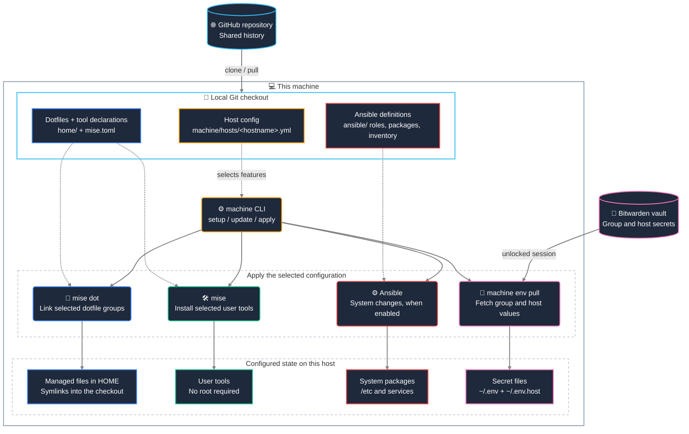
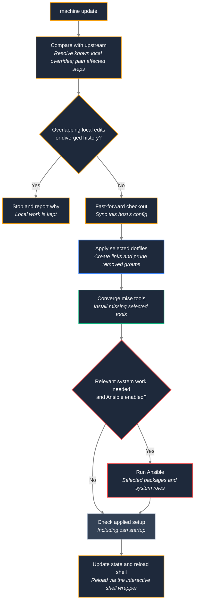

# Dotfiles + machine setup

Shared shell configuration, user tools and machine setup for work and private hosts. Choose a host's context, device and features once; `machine` uses those choices to keep it configured.

- **New host:** run `./bootstrap` from a checkout. It starts guided setup on that host; no separate control node is needed.
- **Existing host:** run `machine update`. Preview first with `machine update --check`.
- **Shared settings:** managed files in `$HOME` are symlinks into this checkout. Edit, commit and push here; update the other hosts to receive the change.
- **Local settings and secrets:** stay in host-local files. User tools work without root; Ansible handles system changes and can be disabled per host with `ansible: false`.

[Quick start](#quick-start-on-the-new-host-no-control-node) · [Common commands](#day-to-day) · [How it fits together](#how-the-pieces-fit) · [Host configuration](#context-device-hardware-and-features) · [Secrets](#secrets--bitwarden) · [Tests](#tests)

## How the pieces fit

The checkout holds the desired configuration. On each host, `machine` reads its host config and coordinates three jobs: link dotfiles, install user tools, and apply system configuration. Dotfiles and tools are applied before Ansible; secrets are fetched only with an unlocked vault.

**Color key:** cyan = Git; amber = host selection and orchestration; blue = dotfiles; green = mise tools; red = Ansible/system; pink = secrets. Solid arrows show actions or outputs; dotted arrows supply configuration.



For host selection rules, see [Context, device, hardware and features](#context-device-hardware-and-features); for the repository map, see [Layout](#layout).

## Quick start (on the new host, no control node)

```bash
git clone https://github.com/ditschi/dotfiles.git ~/dotfiles
cd ~/dotfiles
./bootstrap
```

Or in one step, which clones the repository to `~/dotfiles` (override with `DOTFILES_DIR`; needs `git` and a public repository):

```bash
curl -fsSL https://raw.githubusercontent.com/ditschi/dotfiles/main/bootstrap | bash
```

Bootstrap links `~/.local/bin/machine` to `machine_cli/machine` in the checkout. An existing clone is used as it is; update it with `machine update`.

Non-interactive:

```bash
./bootstrap --context private --device desktop --yes
./bootstrap --context work --device desktop --yes
./bootstrap --context private --device server --yes
```

From the laptop to a reachable device:

```bash
./bootstrap --limit rpi-zero-1 --context private --device server
```

## Day to day

| Action | Command |
| --- | --- |
| Change an alias for all hosts | Edit the file in `$HOME` (it is the repo file), `machine commit -m "..." && machine push` |
| Bring other hosts up to date | `machine update` (pulls, runs only the affected steps) |
| Apply repository/user-space changes without system provisioning | `machine update --skip-ansible` |
| Packages/system | `machine update --system` or `machine apply` |
| Apply a host config remotely | `machine apply --limit homeserver` |
| Full setup / change features | `machine setup` (saved answers as defaults) |
| Save the host config to the repo | `machine host save` |
| Status / drift | `machine status` / `machine host show` |
| Inventory (vault) | `machine inventory edit ansible/inventory/hosts.yml` |
| `~/.env` from Bitwarden | `machine env pull` |
| Resolve different SSH keys (host / Bitwarden) | `machine ssh sync` |
| Install collections | `ansible-galaxy collection install -r ansible/requirements.yml` |

`machine apply --skip-ansible` syncs the applied host config but skips Ansible and bootstrap system provisioning for that invocation. `machine update --skip-ansible` still merges repository changes and applies dotfiles/user-space tools, but leaves system changes pending for a later `machine update --system` or `machine apply`. This is a one-run override; it does not write `ansible: false` to the host config. If both `--skip-ansible` and `--system` are passed to update, the explicit skip wins.

`machine update` only runs what changed upstream: the tool install (`mise install`, plus the Azure CLI via `uv tool`) for a changed `home/core/.config/mise/*`, the dotfile apply (`mise dot apply --prune`) for added/removed files under `home/` or a changed `mise.toml`, Ansible when `ansible/**` changed in a part that applies to this host (roles of features this host does not have, docs and inventory are ignored, and so is a feature-table change to `help` or `groups` only; a host never set up by Ansible or with `ansible: false` gets no system step), a host-config sync when `machine/hosts/**` changed. Local edits are kept: a trial merge (`git merge-tree`, nothing changes) decides whether an edited file that is also changed upstream merges cleanly; then the update keeps the edit and continues. Only a real conflict stops it. On a terminal it shows the diff (through delta) and the incoming commits, and offers *resolve manually* (default; prints the git commands, resolve outside `machine`) or *put the conflicting changes into the stash and update*; `--force` makes the second choice without asking. Stash entries made by `machine` are named `machine update <date>: <why>`; `machine status` counts them and `machine attention` shows each one and asks whether to restore, drop or keep it. When history diverged, a manual update rebases the local commits onto the upstream if a trial rebase (`git replay`) is clean, no local commit is on a remote branch, none is a merge commit, commit signing is off and no rebase/merge is in progress; otherwise it stops with `git pull --rebase` as the hint. `machine update --check [--json]` shows the plan (including the files that merge cleanly and the conflicts) without changing anything. The background job (`machine update --auto`, every 6 hours via the user timer) applies home-only changes on its own and keeps local changes that merge cleanly; it stops on a conflict or a diverged history (it never stashes or rebases): it fast-forwards to just before the first commit that touches `ansible/**` or this host's config, runs the dotfile apply when needed, then runs the zsh health check; if zsh no longer starts it reverts to the previous revision, restores the local changes, does not retry that revision and shows needs-attention (the check output is kept for `machine attention`). A manual update runs the same zsh check; on a failure it shows the output, sets needs-attention and does not reload the shell. Everything from the first system commit on stays pending for a manual `machine update`. Every `machine update` ends with a converge check (dotfile apply and tool install, also when nothing is incoming), and on a terminal the shell is reloaded afterwards by the `machine` shell function. A failed tool install reverts like a failed zsh check. `MACHINE_SKIP_TOOLS=1` skips the tool install in `machine setup` (tests). `machine setup` and `machine update` also enable systemd linger for the user (best effort, not in containers; on failure they print `sudo loginctl enable-linger <user>`), so the timer runs on headless hosts without a login. Managed blocks added to `~/.bashrc` by other tools are moved to `~/.bashrc-local` (sourced at the end of `.bashrc`).

The background update check (`dotfiles-update-check-job`) and `machine update` write `~/.dotfiles-update-state` (`state`, `reason`, `revision`, `pending`, `failed_revision`, `ansible_applied_rev`, `stash`; the only state file). Interactive zsh and bash show it in the prompt (Starship `env_var` module; without Starship, at the right of the zsh prompt or as a `PS1` prefix in bash), re-read before every prompt without forking: `⬆ dotfiles update` (run `machine update`), `↻ reload shell` (an update was applied after this shell started; run `reload`), `⚠ dotfiles: check` (needs attention, e.g. diverged history; a line with the reason is also printed at shell start). A shell started after the update shows nothing. Next to it a red `⚠ disk /mnt/data 97%` segment names every filesystem low on space or inodes (read-write ext4, xfs, btrfs and vfat, found from the mounts; low below 5 % **and** below 20 GiB free, or below 5 % free inodes; per mount point `disk_space` in the host config, see [machine/hosts/README.md](machine/hosts/README.md)). `machine` records it in `~/.local/share/machine/disk-state` at the end of every command and the user timer `machine-disk-check.timer` every 15 minutes (`machine disk` shows it, `--record` only writes the state); nothing is printed at shell start. `machine status` is a short overview (branch and how far behind, the attention reason and what to run, incoming steps, local change counts, stash entries, low filesystems, host, features in columns, dotfile groups; colors only on a terminal); `machine status -v` adds the file lists, the applied host config and the dotfile groups file. `machine attention` (also plain `machine`, which prints the help when all is clean) lists open items (blocked or failed update, stash entries, pending system update, SSH key difference, local-override conflicts, Telegraf not installed / without output / not running on a host with `monitoring`, a filesystem low on space or inodes) and offers to resolve each on a terminal. The disk item names the mount point and its usage, shows the known space users on that filesystem (Docker data with `docker`, journal, apt cache, mise cache, `~/.cache`), cleans only what you pick and scans the biggest directories only on request. A blocked update comes first; while it is open the pending system step is part of it, so `machine apply` is not offered on the old checkout. When linking dotfiles, an existing regular file at a target is deleted if identical to the repository file, else moved to `<name>.pre-dotfiles`.

`~/.zshrc-local` is only for genuine single-host exceptions and is not in git.

### Shell: prompt and plugins

Both shells use [Starship](https://starship.rs) with the shared `~/.config/starship.toml` (every host). The prompt character shows the shell: a green `❯` in zsh, a purple `❯` in bash; `🐳` marks a container, and a failed command shows in the status segment. Without Starship both shells fall back to a plain prompt (directory and `❯`).

Shell configuration is under `~/.shell/{common,bash,zsh}`; each shell has an explicit ordered loader, and work-only files live in the separately selected work dotfile group at `~/.shell/work/{common,zsh}`. Shared `.sh` files must run in both Bash and zsh; Readline and ZLE integrations stay shell-specific. `.bashrc` performs the handoff before loading the Bash fallback, while `.zshrc` starts the explicit zsh loader. `~/.bashrc-local` and `~/.zshrc-local` remain host-only final extension points.

`~/.shell/common` owns aliases, env-file loading, machine profile, update/cache helpers and command-prefix matching. `~/.shell/bash/init.bash` explicitly loads the Bash handoff support, options, tools, shared environment/aliases, history, guarded work modules, Readline bindings and prompt. `~/.shell/zsh/init.zsh` loads profile and shared helpers, zsh options/tools and environment, guarded work modules, history, plugins, prompt and keybindings; machine completion is registered after deferred or fallback `compinit`. Adding a module does not load it until its shell loader names it.

`machine update` or `machine apply` applies the selected shell links. To roll back a layout change, restore the previous repository revision and run `machine update` so the managed links are reapplied; keep local override files and plugin/cache data in place.

zsh plugins are managed by [antidote](https://antidote.sh): edit `~/.shell/zsh/plugins.txt` (one plugin per line; order matters) and open a new shell — the generated `~/.cache/zsh/plugins.zsh` is rebuilt and missing plugins are cloned to `~/.local/share/antidote`. `antidote update` updates them. The prompt appears first; completion (`compinit`), machine completion, fzf-tab, history-substring-search, autosuggestions and fast-syntax-highlighting load in their declared deferred order via zsh-defer. Tools such as fzf, zoxide, eza, fd, delta and Starship come from mise; their shell init is cached in `~/.cache/zsh` and regenerated when the binary changes.

bash is a fallback with the same tools: Starship, fzf (Ctrl+R), zoxide (`z`), LS_COLORS and the git helpers (`git open`, `git recent`, `git recall`) from the antidote checkouts, Up/Down prefix search, Esc Esc for `sudo`, and pasting commands with a leading `$ ` or `❯ `.

Data of the former zinit/Powerlevel10k setup is not removed automatically. After the switch it can be deleted with:

```bash
rm -rf ~/.local/share/zinit ~/.cache/p10k-* ~/.cache/gitstatus
```

Before bash hands over to zsh, a startup health check runs. If zsh fails or loads only partly, the shell stays in bash and prints one line with the reason. The result is cached until a shared or zsh module, work startup file, plugin list, entry point, health checker, zsh binary or `~/.preferred-shell` changes, or dotfiles are updated. After fixing the cause, run `zsh-recheck` to clear the cache and check again.

### Terminal multiplexer

[zellij](https://zellij.dev) is installed on every host (mise, `10-shell.toml`) and runs with its default key bindings; the bar at the bottom shows the available keys. Start it by hand with `zellij`; shells never start it automatically. Ctrl+G locks zellij so that every key goes to the program in the pane (for example Ctrl+T for the fzf file search, or Ctrl+O in nano), and Ctrl+G unlocks it again. Text selected with the mouse inside zellij (no Shift needed) goes to the primary selection, so a middle click pastes it; `~/.config/zellij/config.kdl` sets `copy-selection` (`wl-copy --primary` on Wayland, `xclip`/`xsel` on X11) because GNOME Terminal and Ptyxis ignore zellij's default OSC 52 copy. Without a graphical session (SSH) the selection is not copied; Shift + mouse selects with the terminal as before. tmux stays available with `~/.tmux.conf`.

### Node and LLM tools

Node LTS (with npm) comes from mise (`20-tools.toml`), user-local and without sudo.
NVM and pyenv are no longer loaded by the shell configuration.

The LLM CLIs are features with their own dotfile groups: `claude-code` (group `claude`),
`copilot-cli` (group `copilot`) and `opencode` (group `opencode`). Each also selects the
group `openspec`, so OpenSpec comes with any of them. Private hosts preselect Claude Code,
work hosts Claude Code and Copilot; opencode and containers are opt-in. mise installs
them without sudo; authentication remains a manual step.

On hosts where `$HOME` is a symlink or bind mount (for example `/home/u` → `/mnt/data/home/u`), VS Code's Copilot CLI wrapper in `…/github.copilot-chat/copilotCli` fails to drop itself from `PATH` and starts itself recursively until memory runs out. `~/.shell/common/environment.sh` therefore rewrites that `PATH` entry to its canonical path, so `copilot` reaches the mise-installed CLI. `machine status` notes such a home in the host row (`home is …`).

### Git config

- `~/.gitconfig` → symlink into the repo, identical on all hosts. `git config --global alias.x ...` lands there directly → commit, done.
- `~/.gitconfig.local` → host-local, not in git, included after the shared settings. `machine setup` creates it once from the context (`work` → work user, otherwise private) and never overwrites it; on work hosts an existing file only gets a missing `http.sslCAInfo` appended. Signing key, `safe.directory`, credentials and proxy go here.
- Owner rules at the end of `~/.gitconfig` override the host default by remote URL: github.com `bosch-*`/`bosch_*`/`*_bosch` owners (HTTPS and SSH), GHES and Bitbucket → `~/.config/git/work.gitconfig`, any other github.com owner → `~/.config/git/private.gitconfig`. Each sets identity plus the GitHub credential username and helper. A repository name ending in `_bosch` does not select the work identity.
- `git-credential-env VAR` serves tokens from the environment or `~/.env` (`GITHUB_TOKEN`, `BDC_GITHUB_TOKEN`, `GITHUB_PRIVATE_TOKEN`) and never stores them. When a GUI-started process lacks the token, it sources only `~/.shell/common/environment.sh` in Bash; it does not start interactive shell initialization. For github.com the variable follows the host type: `GITHUB_TOKEN` on private hosts, `GITHUB_PRIVATE_TOKEN` on work hosts (where `GITHUB_TOKEN` is the work token); `machine` writes the choice to `~/.config/git/github-token.gitconfig` on every dotfile apply. On private hosts `machine setup` also switches the checkout's `origin` to SSH (`git@github.com:…`) when the SSH key authenticates at GitHub, so pushing needs no token. `~/.netrc` entries for the same host take precedence in curl, so keep GitHub out of it.
- Single repo with a different identity: `git user-work` / `git user-private` (repo-local include of the same snippet), undo with `git user-unset-local`; show: `git user-show`.
- `machine update` and `machine commit` move host-only entries from the shared config into `~/.gitconfig.local`. A key that is absent locally moves, an equal value is dropped from the shared file, and a different local value is a conflict that `machine update` asks about (non-interactive runs keep both and leave the shared file dirty). Repeated values are preserved. Backups live under `~/.local/share/machine/local-overrides-backup/`. Text added to `~/.bashrc` is handled the same way: known text is removed silently, new text is moved only when you select it, and moved text stands between `# machine-local begin/end` markers in `~/.bashrc-local`.
- The installed pre-commit hook does the same before an ordinary Git commit. If it changes the shared file, review and stage the cleaned file, then commit again.
- CI runs `python3 -m machine_cli.local_overrides --check` and fails on committed host-only entries or invalid config. Hooks also run read-only when `CI=true`. Restricted keys include user identity/signing keys, signing settings, `safe.*`, `credential.*`, `http.*`, `https.*` and `core.sshCommand`; `user.useConfigOnly` remains shared.

### Project Containers

`sde` runs the current project's `.devcontainer/sde.sh` when present, forwarding
arguments and its exit status. Non-executable scripts run through Bash. Without
that file, the shared Bash launcher is used. `sdx` calls that launcher in extended
mode, mounting the selected dotfiles checkout, plugin/apt caches, host HOME and
per-project history. Set `SDE_CONTAINER_HOME` if the container HOME differs from
the host HOME. Initialization runs before Compose; extended setup runs before
post-start and the shell or supplied command. Interactive sessions prefer zsh,
falling back to Bash.

Existing images can be reused or rebuilt, and interactive callers can attach to
existing project containers. `sdx` only offers containers created in extended
mode. Rebuilding starts a new container rather than attaching to one using the
old image. One-off commands reuse the image but always run in a fresh container,
without prompts or forced TTY allocation. To force a rebuild, invoke
`command sde --extended --rebuild -- <cmd> [args...]` (omit `--extended` for minimal
mode). The shell wrappers pass arguments as commands; shell expressions should
be explicit, e.g. `sdx bash -lc 'echo ready && make test'`.

## Layout

```
bootstrap                 # clones if piped, installs uv, links machine, calls machine setup
machine_cli/              # the machine CLI: `machine` script + package (not deployed as a dotfile)
home/                     # dotfile groups: core, prompt, systemd, work (applied by `mise dot`); `mise.toml` declares them
machine/
  hosts/                  # versioned host answers (<hostname>.yml)
  ssh_keys/               # public host keys for ssh_allow_from
ansible/
  workstation.yml         # packages + monitoring + sshd + stylus
  homelab.yml             # stub — stacks live in the homelab repo
  requirements.yml        # ansible.posix (+ Galaxy notes)
  inventory/local.yml     # always localhost
  inventory/hosts.example.yml
  group_vars/all/         # packages.yml (apt per feature), features.yml (feature table)
  tasks/detect_hardware.yml # laptop, Raspberry Pi, Pi Zero
  roles/
    monitoring/           # Telegraf agent configs
    sshd_home/            # authorized_keys
    stylus_touch_guard/   # Yoga stylus/touch (ex helpers-and-automation)
    touch_device/         # GNOME touch extensions (TouchUp, Screen Rotate)
    cosmic_desktop/       # COSMIC session on Ubuntu 26.04+ from ppa:hepp3n/cosmic-epoch
    lid_switch/ power_profile_switch/ battery_charge_limit/  # laptop features (detected laptops)
    zram_swap/            # compressed swap in RAM (not on Raspberry Pis)
    thinkpad_l13_yoga_gen2/ # model role: S3 suspend, tablet OSK (selected by DMI)
tests/                    # unit + Docker/CI
```

`machine_cli/machine` is a [PEP 723](https://peps.python.org/pep-0723/)
script (shebang `uv run --script`, Python 3.11–3.13) — its dependencies (click, rich,
PyYAML) are declared inline and resolved by [uv](https://astral.sh/uv) on first
run, no manual venv. `./bootstrap` installs `uv` itself if it's missing. `~/.local/bin/machine`
is a symlink to it, so the checkout is found by resolving the link and can be anywhere; because
the dotfile tool does not deploy the CLI, a plain `git pull` cannot leave it half updated. `machine_cli/`
(code) is not to be confused with `machine/` (host data).

`machine --debug <command>` (or `DEBUG=1`) prints every command the CLI
runs and passes `-v` to Ansible.
 repos follow once the main repos are on Copier. Repo-owned files are never to
The script itself only defines the command line. The implementation is the package
`machine_cli/` next to it:

| Module | Content |
| --- | --- |
| `core` | constants (contexts, devices, features) and pure helpers |
| `system` | everything touching the outside world (`run`, `have`, tty, hostname); tests replace these here |
| `features` | the feature table: defaults, menu, dotfile groups |
| `profile` | host config (context, device, features), applied copy, prompts |
| `tools` | bootstrap tools, git / ansible runners |
| `dotfiles`, `mise_tools`, `mise_check`, `terminal_fonts` | dotfile groups (`mise dot`), tool install, fragment checks, terminal fonts |
| `bw_client`, `env_pull`, `ssh_keys` | Bitwarden client, `~/.env`, per-host SSH keys |
| `commands` | setup, apply, update, status, commit, push |
| `updates`, `auto_update`, `local_changes`, `local_overrides`, `system_relevance` | update plan and resolvers, background update, relevance filter |
| `attention`, `events` | `machine attention`, local event log |
| `machine` | the `Machine` class combining the modules above |

**Only source per host:** the host config [`machine/hosts/<hostname>.yml`](machine/hosts/) — `context`, `device`, features, `ssh_allow_from` and optionally `ansible: false`. `machine setup` writes the selection there directly (also with `--yes`) and offers to commit; commit and push it to share. A host's file can also be changed from another host: the next `machine update` (or the background job) takes it over without a question and prints what changed (for example `+ thunderbird`); `machine update --check` lists it beforehand.  
Applied copy: `~/.local/share/machine/applied-host.yml` (not in git, written only by `machine`; hand edits are undone by the next update; a former `~/.config/machine/profile.yml` is taken over once). It is the state a failed apply reverts to, what the shell reads at start, and the host config of containers. Dotfile groups of the host: `~/.config/mise/config.local.toml` (written by `machine`).

### Versioning and pushing host configs

```bash
# On the host, once (or after changing features):
machine setup                 # interactive
machine host save             # → machine/hosts/$(hostname -s).yml
machine commit -m "host config" && machine push

# Laptop: allow SSH from this laptop to the server
# edit machine/hosts/homeserver.yml → ssh_allow_from: [this-hostname]
# A new host gets its host config from `machine setup`; to prepare one for
# `machine apply --limit <host>` write machine/hosts/<host>.yml by hand
# (context, device, features, ssh_allow_from), like the files already there.
machine commit -m "allow laptop on homeserver" && machine push

# On the server:
machine update                # pull → sync host config → apply on drift

# Or from the laptop without logging in to the server:
machine apply --limit homeserver
```

`machine apply` locally: if Ansible or the health check fails, the previously applied host config is restored. The health check fails when the zsh startup check fails or when the group configuration cannot be read (unprivileged checks only; telegraf is a warning). The same restore applies to the apply step of `machine update`. If the host config changed, Ansible runs again with the old state. Remote (`--limit`): no auto-revert — fix the host config in git and apply again.

The recovery Ansible run only happens when syncing the host config changed it;
an unchanged host config is restored without repeating the same failed command.
Package and system changes are not transactionally rolled back.

Managed work machines may allow only specific sudo commands. The workstation
playbook requires approval to execute Ansible modules as root, not just permission
to run selected APT commands. A correct sudo password does not grant that approval.
If fact gathering reports "not allowed to execute", stop and contact the machine
administrator for an approved deployment route. `--no-become` only suppresses the
password prompt; it does not disable the playbook's root tasks. For such a host set
`ansible: false` in its host config: setup, apply and update then skip Ansible, while
dotfiles, tools and environment management stay active.

## Secrets / Bitwarden

On real hosts, setup installs the **CLI** (`bw`) to `~/.local/bin` (not the GUI snap).
Interactive `machine setup` offers Bitwarden configuration and login before
fetching secrets. For an unauthenticated CLI, it asks for the HTTPS server URL
(including self-hosted servers). Already authenticated accounts keep their server.
Passwords and two-factor codes are entered locally through the CLI.

After a successful unlock and sync, a separate, default-no prompt offers to save
`BW_SESSION`, `NODE_EXTRA_CA_CERTS`, and `NODE_USE_ENV_PROXY` in `~/.env.local`
with mode 600. Existing unrelated content is preserved, and repeated setup replaces
these exports rather than duplicating them. The helper first tries the existing
network settings. Only on a certificate trust error does it offer Ubuntu's system
CA bundle; only on a DNS/connection error with an HTTPS proxy configured does it
offer Node environment-proxy support. Neither workaround is added automatically,
and TLS verification stays enabled. Kerberos authenticates the proxy but does not
configure application proxy support or certificate trust.
Existing literal local exports are loaded without executing the file.

Saving the token grants local processes vault access while it remains valid;
it is never uploaded to Bitwarden or printed. Unlock again after expiry.
Declining storage keeps the session only for the setup process.
`--yes` / non-interactive setup never prompts or persists unlock tokens.
Without an unlocked vault, environment fetching and key uploads are skipped.

### Inventory

- Copy real hosts/IPs to `ansible/inventory/hosts.yml` and encrypt it with Ansible Vault.
- Vault password lives in Bitwarden, item name `ansible-vault` (override: `MACHINE_VAULT_BW_ITEM`).
- Roles and package lists stay plain text.

```bash
cp ansible/inventory/hosts.example.yml ansible/inventory/hosts.yml
machine inventory encrypt ansible/inventory/hosts.yml
```

### `~/.env` from Bitwarden

Change the password in Bitwarden, then run `machine env pull` or `machine update` on the host. Bitwarden never pushes to devices — the host fetches the current state on apply (`bw sync`). Without an unlocked `bw`, the last `~/.env` stays in place.

The shell loads exactly these files, in order (later assignments win):

| File | Contents | Ownership |
| --- | --- | --- |
| `~/.env` | The context's Bitwarden group item | Generated |
| `~/.env.host` | This host's Bitwarden item | Generated |
| `~/.env.local` | Local overrides, certificate/proxy exports, `BW_SESSION` | Local, never overwritten |

The arrows distinguish fetching from shell loading. The shell loads the three files in order; later assignments win.

```mermaid
graph LR
  linkStyle default stroke:#808080,stroke-width:2px;
  Group["Bitwarden group item<br/><i>env/groups/&lt;group&gt;</i>"]
  Host["Bitwarden host item<br/><i>env/hosts/&lt;hostname&gt;</i>"]
  Pull["machine env pull<br/><i>Unlocked vault; back up changed files</i>"]
  Shared["1. ~/.env<br/><i>Generated group values</i>"]
  Specific["2. ~/.env.host<br/><i>Generated host values</i>"]
  Local["3. ~/.env.local<br/><i>Local only; never overwritten by pull</i>"]
  Shell["Shell environment<br/><i>Last assignment wins</i>"]

  Group --> Pull
  Host --> Pull
  Pull -->|writes group values| Shared
  Pull -->|writes host values| Specific
  Shared -.->|then load| Specific
  Specific -.->|then load| Local
  Local -.-> Shell

  classDef source fill:#1E293B,stroke:#38BDF8,stroke-width:2px,color:#fff;
  classDef control fill:#1E293B,stroke:#F59E0B,stroke-width:2px,color:#fff;
  classDef dotfiles fill:#1E293B,stroke:#3B82F6,stroke-width:2px,color:#fff;
  classDef mise fill:#1E293B,stroke:#10B981,stroke-width:2px,color:#fff;
  classDef system fill:#1E293B,stroke:#EF4444,stroke-width:2px,color:#fff;
  classDef secrets fill:#1E293B,stroke:#F472B6,stroke-width:2px,color:#fff;
  classDef context fill:#334155,stroke:#94A3B8,color:#fff;
  class Pull control;
  class Group,Host,Shared,Specific,Local secrets;
  class Shell context;
```



These files are **not** in git and are not symlinks. Before replacing changed
generated files, their previous contents are backed up with owner-only
permissions under `~/.local/share/machine/env-backup/`. Other `~/.env.*` files
are not loaded automatically.

Keep `BW_SESSION` local: it is needed to unlock the vault before fetching items,
and may expire. Pull refuses vault items containing a `BW_SESSION` assignment.
Existing local override files are left byte-for-byte unchanged.

Local-only keys are retained in a new `~/.env.local` when safe. If that overlay
already exists and lacks the keys, or the old file contains complex shell
content, the pull leaves both generated files unchanged, exits with an error, and prints the live and backup paths
for manual review. Existing overlays are never overwritten; secret values are
not printed in warnings.

The group follows the context (`ENV_GROUPS` in `machine_cli/core.py`): `private` → `private`, `work` → `work`, a container without context → none.

Item names (secure note, or login with note + custom fields). Later items and custom fields win for identical keys:

| Layer | Item name | Example |
| --- | --- | --- |
| Group | `env/groups/<group>` | `env/groups/work`, `env/groups/private` |
| This host | `env/hosts/<hostname>` | `env/hosts/ditschi-ThinkPad-L13-Yoga-Gen-2` |
| Infra | `ansible-vault` | vault password |
| Telegraf | `influxdb-telegraf-write` | Influx write token for Telegraf (not for shell `.env`) |

**Folders in Bitwarden** (personal vault) or collections (organization), same names:

- `work` — work laptops only (`env/groups/work`, SSH/VPN)
- `home` — private machines and shared home secrets
- `infra` — `ansible-vault`, host password hashes, not for shell `.env`

**Telegraf item** `influxdb-telegraf-write` (override: `MACHINE_INFLUX_BW_ITEM`): `machine setup`, `machine apply` and the apply step of `machine update` read it before Ansible on hosts with `monitoring` and hand the values only to Ansible (a private temp file, removed afterwards); they never reach `~/.env*`. Custom fields named like the variables win. For a login item, the password is used as `INFLUX_TOKEN` and the first URI as `INFLUX_URL` when those fields are missing.

| Field | Required | Meaning |
| --- | --- | --- |
| `INFLUX_URL` | yes (or login URI) | InfluxDB URL |
| `INFLUX_TOKEN` | for InfluxDB 2.x (or login password) | write token |
| `INFLUX_ORG` | for InfluxDB 2.x | organisation |
| `INFLUX_BUCKET` | no (default `telegraf`) | bucket |
| `INFLUX_TELEGRAF_CONFIG_BASE` | no | load the Telegraf configs from Influx instead of the local fragments |
| `INFLUXDB_USER`, `INFLUXDB_USER_PASSWORD`, `INFLUXDB_DB` | for InfluxDB 1.x | user, password, database (default `telegraf`) |

Missing item or locked vault: the run continues without credentials and keeps an existing Telegraf output.

Contents of an `env/…` item:

- **Notes:** existing `.env` as text (`KEY=value`, one line per variable)
- **Custom fields** (hidden): frequently changed passwords, e.g. `VPN_PASSWORD` — override the same key from the notes

Existing `.env` contents can be transferred manually into an approved work-vault
secure note named `env/groups/work`, or the host item for narrower scope.
Secrets should never be committed to dotfiles. The current pull does not resolve
references to other Bitwarden items: custom-field values are literal values.
Vault folders are organizational labels, not enforced access boundaries; namespaced
item selection does not replace vault/organization permissions.

Don't put work secrets in `env/home-*`. Home hosts never query `env/work-*`.

```bash
machine env status    # which items exist
machine env pull      # write ~/.env and ~/.env.host; preserve ~/.env.local
```

### SSH keys (home / work separated)

One key per host, backed up whole (private key, public key, fingerprint) as a Bitwarden item of type **SSH key**:

- Home: `ssh/home/hosts/<hostname>`
- Work: `ssh/work/hosts/<hostname>`

With the feature `ssh-host-key`, `machine setup` (and so bootstrap) handles the key without asking, using the Bitwarden session setup already has:

1. no local key, but an item in Bitwarden → the key is restored (a reinstalled host keeps its identity);
2. an existing local key → it is uploaded unchanged;
3. neither → an ed25519 key without passphrase is generated (`~/.ssh/id_ed25519_<hostname>`) and uploaded. Register it where needed, for example `gh ssh-key add`.

Existing keys keep their path, permissions and passphrase. Selection order: `MACHINE_SSH_KEY`, `id_ed25519`, `id_rsa`, the hostname key, a sole other candidate; only when several keys make the choice unclear does interactive setup ask, and an ambiguous choice changes nothing. The choice is cached locally. Without an unlocked Bitwarden nothing is generated, restored or uploaded.

`machine update` (the manual one) uploads the key when the item is missing and a Bitwarden session works without a prompt (environment or `~/.env.local`). Without such a session it warns that the key was not checked; log in with `machine env pull` in a terminal. The background job never uses Bitwarden. Only items of type SSH key are read; old secure notes with the same name are ignored.

**Different keys** on the host and in Bitwarden are never resolved automatically: setup and update keep both and list the difference in `machine attention`. There, or with `machine ssh sync`, you choose: `local` (overwrite the item), `bitwarden` (replace the local key; the old one is kept as `<key>.old-<YYYYMMDD>`) or `later`.

**authorized_keys:** for the `home` class, the public key is written to [`machine/ssh_keys/<hostname>.pub`](machine/ssh_keys/) without a question; commit and push it. Work keys never go into the repository. The role `sshd_home` adds the keys of the hosts in `ssh_allow_from` (same class) from there; `machine` does not read public keys from Bitwarden. Setup offers the hosts with a file in `machine/ssh_keys/` for `ssh_allow_from`.

```bash
machine ssh sync              # host and Bitwarden differ: choose which key wins
machine ssh rotate            # new key at ~/.ssh/id_ed25519_<hostname>, old one kept, item overwritten
```

## Context, device, hardware and features

Every host has three levels:

| Level | Values | How it is set | Selects |
| --- | --- | --- | --- |
| Context | `private`, `work` | chosen (default: `work` for a company user ID) | dotfile behaviour (Bitwarden group, Git identity, CA bundle, work group, SSH class, `WORK_SETUP`), work roles; private infrastructure only for `private` |
| Device | `desktop` (graphical session), `server` (none), `container` | chosen (default from the boot target); `container` is set in Docker | graphical features |
| Hardware | laptop, Raspberry Pi, Pi Zero | detected by Ansible (`tasks/detect_hardware.yml`) | Pi Zero package set, Telegraf fragment, Docker only where installable |

The feature table [`ansible/group_vars/all/features.yml`](ansible/group_vars/all/features.yml) lists every feature with its help text, its dotfile groups and, per context and device, `default` (preselected), `optional` or `excluded`; the stricter of the two wins. `machine setup` offers only the features that are not excluded; Ansible applies only those (`machine_features`). A feature in a host config that is excluded or unknown is reported and dropped at the next write.

Adding a feature: one row in the feature table plus either apt packages (`packages_by_feature` in `group_vars/all/packages.yml`), a role with `when: "'<feature>' in machine_features"`, or a dotfile group (`home/<group>/` declared in `mise.toml`, named under `groups:`). The CLI needs no change. Tools for every host go into a `core` fragment instead.

In Docker the device is `container` without context; `MACHINE_CONTEXT_OVERRIDE` and `MACHINE_DEVICE_OVERRIDE` set others (used by `machine testenv` and the tests). `MACHINE_HARDWARE=laptop,pi,pi-zero` replaces the hardware detection in tests.

Private hosts get `monitoring` (Telegraf) by default, installed from the InfluxData apt source. Config names are resolved **only** in `tasks/resolve_monitoring.yml` from the hardware and the device (not in the CLI). The inputs are the local files under `ansible/roles/monitoring/files/`; with `INFLUX_TELEGRAF_CONFIG_BASE` set, the remote Influx configs replace them. The output comes from the Bitwarden item `influxdb-telegraf-write` (see [Secrets / Bitwarden](#secrets--bitwarden)). Telegraf runs only with an output; otherwise it stays stopped and `machine attention` says why. See [ansible/roles/monitoring/README.md](ansible/roles/monitoring/README.md).

Feature `gnome`: besides the apt packages (Flameshot, extension manager), `machine` installs and enables GNOME Shell extensions without root (Ddterm, gTile, Clipboard Indicator, Quick Settings Audio Panel, Audio Devices Hider, Astra Monitor; Tiling Assistant is only enabled) with `gext` from mise. Their shared settings (`home/gnome/.config/machine/dconf/*.ini`) are loaded once per host; delete `~/.local/state/machine/gnome-extension-settings` to load them again. Log out and in afterwards. Host-specific keys (audio device names, Astra storage device) are not shipped. Ddterm is the drop-down terminal (F12); with the feature `fonts`, `machine` sets its font, like the VS Code terminal's, to FiraCode Nerd Font Mono and keeps the size. Guake is no longer installed or configured; an installed Guake is left alone (`sudo apt remove guake` removes it).

Yoga/convertible (L13): feature `stylus-touch-guard` → role `stylus_touch_guard`. Previously: [helpers-and-automation](https://github.com/ditschi/helpers-and-automation) (**archived / deprecated**).
Laptops: features `lid-switch` (closing the lid does nothing), `power-profile-switch` and `battery-charge-limit` (`battery-charge status|normal|full`) are preselected on desktops and applied only on detected laptops; `zram-swap` is preselected everywhere except containers and not applied on Raspberry Pis. Tuning for one model is a role selected by the hardware, not a feature: `thinkpad_l13_yoga_gen2` (S3 suspend, tablet on-screen keyboard), see [docs/thinkpad-l13-yoga-gen2.md](docs/thinkpad-l13-yoga-gen2.md). `MACHINE_HARDWARE` also accepts `l13-yoga-gen2` in tests.
COSMIC: feature `cosmic` (optional on desktops, never on servers or in containers) installs `cosmic-session` on Ubuntu 26.04+ from the unofficial PPA `ppa:hepp3n/cosmic-epoch` (key pinned in the role); GDM stays the display manager, so GNOME and COSMIC can both be chosen at login. Pop!_OS ships COSMIC, so nothing happens there. The feature also selects the dotfile group `cosmic`, whose user unit removes `DCONF_PROFILE` before a GNOME session starts: COSMIC puts it into the systemd user manager, and with linger it would otherwise survive the logout and make the next GNOME login use COSMIC's dconf database. Deselecting removes nothing; see [ansible/roles/cosmic_desktop/README.md](ansible/roles/cosmic_desktop/README.md).
Mail: feature `thunderbird` (default on private desktops) installs Thunderbird and the mise group `home/thunderbird` with `tb` and `tb-bridge` of [thunderbird-cli](https://github.com/vitalio-sh/thunderbird-cli). The bridge extension is not installed automatically, because it accepts any local bridge, also one of another user: `machine` downloads the pinned XPI to `downloads/` in the checkout (gitignored); install it once in Thunderbird (Add-ons and Themes → gear → Install Add-on From File). Start the bridge with `tb-bridge &`, then `tb health`.

SSH home fleet: feature `sshd-home` → `authorized_keys` (`roles/sshd_home`) from [`machine/ssh_keys/`](machine/ssh_keys/) for entries in `ssh_allow_from`.

### Galaxy vs. local roles

| Need | Decision |
| --- | --- |
| Telegraf | **Local** `roles/monitoring` (InfluxData apt source, Bitwarden output + `machine/*` fragments). Galaxy `dj-wasabi.telegraf` / `boutetnico.telegraf` possible, but heavier and a worse fit. |
| Docker | **apt** `docker.io` / `compose-v2`. Later optionally `geerlingguy.docker` or collection `community.docker`. |
| SSH keys | **Local** `sshd_home` + collection `ansible.posix` (`authorized_key`). |
| Stylus | **Local** (ex helpers-and-automation). |

Collections: `ansible-galaxy collection install -r ansible/requirements.yml`.

### Architecture (short)

| Layer | Responsible for |
| --- | --- |
| `machine/hosts/*.yml` | Desired state (context, device, features) |
| `machine` CLI | Orchestration, UX, secrets, git, calling mise and Ansible |
| mise | Dotfile groups and user-space tools without root (`home/core/.config/mise/conf.d/*.toml`, pinned by `mise.lock`) |
| Ansible | apt, `/etc`, Telegraf, stylus-touch-guard, sshd-home |
| Inventory | Reachability only — no features |

### Manual update flow

Preview with `machine update --check` (read-only), then run `machine update`. The diagram shows the normal local path; failure recovery and background updates are described above.



Work modules (`01_work.zsh`) are only linked for the context `work`.

Fresh setup uses the shell's work-account naming rule
(`^[a-zA-Z]{3}[0-9]{1,2}[a-zA-Z]{2,3}$`), so `dci2lr` defaults to the context
`work`. Explicit `--context` / `--device` choices and saved host configs take
precedence outside Docker. In Docker (`/.dockerenv` or `MACHINE_IN_DOCKER=1`) the
device is `container` without context, in the CLI and the shell, and `WORK_SETUP`
stays off; set `MACHINE_CONTEXT_OVERRIDE` / `MACHINE_DEVICE_OVERRIDE` to test
another host in a container. The shell exports `MACHINE_CONTEXT` and `MACHINE_DEVICE`.

Working Azure CLI and GitHub CLI installations are kept, including their
authentication and package sources. Docker provisioning preserves an existing
provider instead of replacing it with `docker.io`; only a missing,
provider-compatible Compose package is added. Unmanaged providers may need
manual Compose setup. Work hosts do not preselect Docker.

User-space tools for every host (`fzf`, `zoxide`, `eza`, `fd`, `starship`, `jq`, `delta`, `lazygit` (started by hand only), `tmux`, `zellij`, `gh`,
`yazi`, Node, `uv`) come from mise fragments in `home/core/.config/mise/conf.d/`; the LLM CLIs,
OpenSpec and the fonts come from the feature groups (`home/<group>/.config/mise/conf.d/`). Versions are pinned in `home/core/.config/mise/mise.lock`
and `locks/` next to it; regenerate them with
`mise lock --global --platform linux-x64,linux-arm64` after a fragment change.
A tool declared in two fragments, or in a fragment and an Ansible package list,
fails `python3 -m machine_cli.mise_check` (pre-commit and CI).

## Tests

### Automated

```bash
uvx nox                         # compile + unit + Ansible lint + Docker smoke (without full APT), in uv venvs
uvx nox -l                      # list sessions; run one with `uvx nox -s tests -- -k handoff`
DOTFILES_TEST_INSECURE_TLS=1 uvx nox -s docker   # test containers skip TLS verification (hosts that intercept TLS)
# automatic on work machines; DOTFILES_TEST_INSECURE_TLS=0 forces verification there
pytest tests/unit -q            # logic incl. apply revert, host YAML schema (needs tests/requirements.txt)
pytest tests/integration -n auto -m "docker and not apt and not apt_gnome"   # -n: parallel (pytest-xdist)
pytest tests/integration -n auto -m apt # Pi Zero APT + tests/hosts/ci-rpi-zero.yml
pytest tests/integration -m apt_gnome  # private desktop APT + ci-home-laptop.yml (slow on a cold cache)
ansible-lint ansible/*.yml      # locally / in CI on changes under ansible/ or machine/hosts/
ansible-galaxy collection install -r ansible/requirements.yml
```

Locally the APT tests download through a caching apt proxy (`dotfiles-test-apt-cache`, apt-cacher-ng on the Docker network `dotfiles-test`), so later runs fetch almost nothing. It is started on first use and kept running; `docker rm -f dotfiles-test-apt-cache` stops it (after a change to `tests/docker/apt-cache/` as well), `docker volume rm dotfiles-test-apt-cache` drops the cache. It is off in CI; `DOTFILES_TEST_APT_CACHE=0|1` overrides. The test image installs no recommended packages.

CI (`.github/workflows/verify.yml`):

- Unit + Ansible syntax (amd64 + arm)
- Docker matrix of context/device combinations (without APT)
- Clean install from `tests/hosts/ci-container.yml`
- APT + Ansible from `tests/hosts/ci-rpi-zero.yml` and `ci-home-laptop.yml` (CI host configs, read through `MACHINE_HOSTS_DIR=tests/hosts`)
- **ansible-lint + host YAML validation** only when `ansible/**`, `machine/hosts/**` or `tests/hosts/**` (or similar) changed

**Deliberately not in CI:** real Pi hardware, Kerberos against the work KDC, Cosmic session, real `bw login`/2FA, real Influx.

### Manual (Compose)

```bash
docker compose -f tests/compose.yaml run --rm shell
# inside the container:
./bootstrap                                # with prompts
./bootstrap --context private --device desktop --yes    # quiet
machine setup                              # previous answers preselected
machine update                             # only bring up to date
```

### Against this home (`machine testenv`)

Runs a command against the real home of this host, as it is right now (including `~/dotfiles` with its branch and local changes), in a container; the home is a read-only lower layer of an overlay, so nothing on the host changes, and all changes inside are discarded on exit. Needs Docker (rootless or rootful) and `/dev/fuse`. The image is built from the host's distribution on first use.

```bash
machine testenv                                        # login shell inside
machine testenv -- 'machine update && machine'         # quote shell syntax, or the host shell runs it
python3 machine_cli/testenv.py -- machine              # same, from a checkout when the installed machine is broken
```

Inside, `machine` uses the host's applied context and device (`--context` / `--device` to change them) and the host name. The container has no systemd user bus and no `bw`, so the timer, linger and `~/.env` steps are skipped there, and Ansible system steps only change the container.
