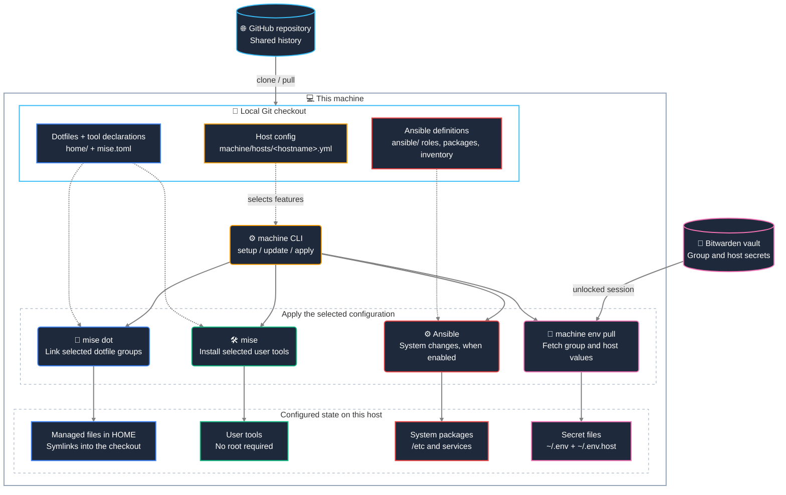

# Dotfiles + machine setup

Shared shell configuration, user tools and machine setup for work and private hosts. Choose a host's context, device and features once; `machine` uses those choices to keep it configured.

- **New host:** run `./bootstrap` from a checkout. It starts guided setup on that host; no separate control node is needed.
- **Existing host:** run `machine update`. Preview first with `machine update --check`.
- **Shared settings:** managed files in `$HOME` are symlinks into this checkout. Edit, commit and push here; update the other hosts to receive the change.
- **Local settings and secrets:** stay in host-local files. User tools work without root; Ansible handles system changes and can be disabled per host with `ansible: false`.

After linking dotfiles, `machine` sets the managed SSH config's checkout target to mode `0600` (owner-only), keeping `~/.ssh/config` as a symlink. This repairs group-writable checkout permissions that OpenSSH rejects; unrelated SSH files and keys are unchanged.

[Quick start](#quick-start-on-the-new-host-no-control-node) · [Common commands](#day-to-day) · [How it fits together](#how-the-pieces-fit) · [Layout](#layout) · [Documentation](#documentation)

## How the pieces fit

The checkout holds the desired configuration. On each host, `machine` reads its host config and coordinates three jobs: link dotfiles, install user tools, and apply system configuration. Dotfiles and tools are applied before Ansible; secrets are fetched only with an unlocked vault.

**Color key:** cyan = Git; amber = host selection and orchestration; blue = dotfiles; green = mise tools; red = Ansible/system; pink = secrets. Solid arrows show actions or outputs; dotted arrows supply configuration.



For host selection rules, see [docs/host-config.md](docs/host-config.md); for the repository map, see [Layout](#layout).

## Quick start (on the new host, no control node)

```bash
git clone https://github.com/ditschi/dotfiles.git ~/dotfiles
cd ~/dotfiles
./bootstrap
```

Or in one step, which clones the repository to `~/dotfiles` (override with `DOTFILES_DIR`; needs `git` and a public repository):

```bash
curl -fsSL https://raw.githubusercontent.com/ditschi/dotfiles/main/bootstrap | bash
```

Bootstrap links `~/.local/bin/machine` to `machine_cli/machine` in the checkout. An existing clone is used as it is; update it with `machine update`.

Non-interactive:

```bash
./bootstrap --context private --device desktop --yes
./bootstrap --context work --device desktop --yes
./bootstrap --context private --device server --yes
```

From the laptop to a reachable device:

```bash
./bootstrap --limit rpi-zero-1 --context private --device server
```

## Day to day

| Action | Command |
| --- | --- |
| Change an alias for all hosts | Edit the file in `$HOME` (it is the repo file), `machine commit -m "..." && machine push` |
| Bring other hosts up to date | `machine update` (pulls, runs only the affected steps) |
| Apply repository/user-space changes without system provisioning | `machine update --skip-ansible` |
| Packages/system | `machine update --system` or `machine apply` |
| Apply a host config remotely | `machine apply --limit homeserver` |
| Full setup / change features | `machine setup` (saved answers as defaults) |
| Save the host config to the repo | `machine host save` |
| Status / drift | `machine status` / `machine host show` |
| Inventory (vault) | `machine inventory edit ansible/inventory/hosts.yml` |
| `~/.env` from Bitwarden | `machine env pull` |
| Resolve different SSH keys (host / Bitwarden) | `machine ssh sync` |
| Install collections | `ansible-galaxy collection install -r ansible/requirements.yml` |

`machine update --check` shows the plan without changing anything. `--skip-ansible` is a one-run override; for a host that must never run Ansible set `ansible: false` in its host config. Details: [docs/update.md](docs/update.md).

`~/.zshrc-local`, `~/.bashrc-local`, `~/.gitconfig.local` and `~/.ssh/config.local` are host-only and not in git.

## Layout

```
bootstrap                 # clones if piped, installs uv, links machine, calls machine setup
machine_cli/              # the machine CLI: `machine` script + package (not deployed as a dotfile)
home/                     # dotfile groups: core, prompt, systemd, work (applied by `mise dot`); `mise.toml` declares them
machine/
  hosts/                  # versioned host answers (<hostname>.yml)
  ssh_keys/               # public host keys for ssh_allow_from
ansible/
  workstation.yml         # packages + monitoring + sshd + stylus
  homelab.yml             # stub — stacks live in the homelab repo
  requirements.yml        # ansible.posix (+ Galaxy notes)
  inventory/local.yml     # always localhost
  inventory/hosts.example.yml
  group_vars/all/         # packages.yml (apt per feature), features.yml (feature table)
  tasks/detect_hardware.yml # laptop, Raspberry Pi, Pi Zero
  roles/
    monitoring/           # Telegraf agent configs
    sshd_home/            # authorized_keys
    stylus_touch_guard/   # Yoga stylus/touch (ex helpers-and-automation)
    touch_device/         # GNOME touch extensions (TouchUp, Screen Rotate)
    cosmic_desktop/       # COSMIC session on Ubuntu 26.04+ from ppa:hepp3n/cosmic-epoch
    lid_switch/ power_profile_switch/ battery_charge_limit/  # laptop features (detected laptops)
    zram_swap/            # compressed swap in RAM (not on Raspberry Pis)
    thinkpad_l13_yoga_gen2/ # model role: S3 suspend, tablet OSK (selected by DMI)
tests/                    # unit + Docker/CI
```

`machine_cli/` (code) is not to be confused with `machine/` (host data). The only source per host is its host config [`machine/hosts/<hostname>.yml`](machine/hosts/).

## Documentation

| Topic | File |
| --- | --- |
| Updates, prompt state, `machine status` / `attention`, failed apply | [docs/update.md](docs/update.md) |
| Context, device, hardware, features; sharing host configs | [docs/host-config.md](docs/host-config.md) |
| Notes on single features (monitoring, GNOME, laptops, COSMIC, Thunderbird, …) | [docs/features.md](docs/features.md) |
| Bitwarden, inventory, `~/.env*` | [docs/secrets.md](docs/secrets.md) |
| SSH keys, `authorized_keys`, SSH client config | [docs/ssh.md](docs/ssh.md) |
| Shell: prompt, plugins, completion, zellij | [docs/shell.md](docs/shell.md) |
| User tools from mise, Node, LLM CLIs | [docs/tools.md](docs/tools.md) |
| Git config and identities | [docs/git.md](docs/git.md) |
| Project containers (`sde`, `sdx`) | [docs/project-containers.md](docs/project-containers.md) |
| `machine` CLI internals, layers, Galaxy vs. local roles | [docs/architecture.md](docs/architecture.md) |
| Tests, CI, `machine testenv` | [docs/testing.md](docs/testing.md) |
| ThinkPad L13 Yoga Gen 2 | [docs/thinkpad-l13-yoga-gen2.md](docs/thinkpad-l13-yoga-gen2.md) |
| Fingerprint login (manual) | [docs/fingerprint.md](docs/fingerprint.md) |

Requirements and recorded decisions: [openspec/specs/](openspec/specs) and the archived changes under [openspec/changes/archive/](openspec/changes/archive).

## Tests

```bash
uvx nox                         # compile + unit + Ansible lint + Docker smoke
pytest tests/unit -q            # unit tests only
```

More in [docs/testing.md](docs/testing.md).
