# Secrets / Bitwarden

The Bitwarden CLI, the vaulted inventory and the `~/.env*` files.

## Bitwarden CLI

Every host gets the **CLI** (`bw`, not the GUI snap) from mise as the `core` tool
`bitwarden`: the official Bitwarden release build for x86_64 and aarch64, with version and
checksums pinned in `mise.lock`. The version is fixed in the fragment (2026.10.1 fails
against the own Vaultwarden 2026.6.0); raise it only after checking it against the server. When `machine` needs `bw` before the dotfiles are linked,
it installs that pinned version from the repository's mise config. A `~/.local/bin/bw`
left by older setups is removed once mise provides `bw`.
Interactive `machine setup` offers Bitwarden configuration and login before
fetching secrets. For an unauthenticated CLI, it asks for the HTTPS server URL
(including self-hosted servers). Already authenticated accounts keep their server.
Passwords and two-factor codes are entered locally through the CLI.

After a successful unlock and sync, a separate, default-no prompt offers to save
`BW_SESSION`, `NODE_EXTRA_CA_CERTS`, and `NODE_USE_ENV_PROXY` in `~/.env.local`
with mode 600. Existing unrelated content is preserved, and repeated setup replaces
these exports rather than duplicating them. The helper first tries the existing
network settings. Only on a certificate trust error does it offer Ubuntu's system
CA bundle; only on a DNS/connection error with an HTTPS proxy configured does it
offer Node environment-proxy support. Neither workaround is added automatically,
and TLS verification stays enabled. Kerberos authenticates the proxy but does not
configure application proxy support or certificate trust.
Existing literal local exports are loaded without executing the file.

Saving the token grants local processes vault access while it remains valid;
it is never uploaded to Bitwarden or printed. Unlock again after expiry.
Declining storage keeps the session only for the setup process.
`--yes` / non-interactive setup never prompts or persists unlock tokens.
Without an unlocked vault, environment fetching and key uploads are skipped.

A `BW_SESSION` in the environment or in `~/.env.local` means Bitwarden is set up
and expected. When it has expired, an interactive run (terminal, no `--yes`)
unlocks, or logs in when logged out, at once without a yes/no question, and a
renewed session replaces the saved one. Without a terminal, and in the background
update (which then calls only `bw status`), an expired session shows
`⚠ bitwarden: log in (machine)` in the prompt and an item in `machine attention`
that offers to log in.

## Inventory

- Copy real hosts/IPs to `ansible/inventory/hosts.yml` and encrypt it with Ansible Vault.
- Vault password lives in Bitwarden, item name `ansible-vault` (override: `MACHINE_VAULT_BW_ITEM`).
- Roles and package lists stay plain text.

```bash
cp ansible/inventory/hosts.example.yml ansible/inventory/hosts.yml
machine inventory encrypt ansible/inventory/hosts.yml
```

## `~/.env` from Bitwarden

Change the password in Bitwarden, then run `machine env pull` or `machine update` on the host. Bitwarden never pushes to devices — the host fetches the current state on apply (`bw sync`). Without an unlocked `bw`, the last `~/.env` stays in place.

The shell loads exactly these files, in order (later assignments win):

| File | Contents | Ownership |
| --- | --- | --- |
| `~/.env` | The context's Bitwarden group item | Generated |
| `~/.env.host` | This host's Bitwarden item | Generated |
| `~/.env.local` | Local overrides, certificate/proxy exports, `BW_SESSION` | Local; only appended to when you choose "keep locally" |

The arrows distinguish fetching from shell loading. The shell loads the three files in order; later assignments win.

```mermaid
graph LR
  linkStyle default stroke:#808080,stroke-width:2px;
  Group["Bitwarden group item<br/><i>env/groups/&lt;group&gt;</i>"]
  Host["Bitwarden host item<br/><i>env/hosts/&lt;hostname&gt;</i>"]
  Pull["machine env pull<br/><i>Unlocked vault; back up changed files</i>"]
  Shared["1. ~/.env<br/><i>Generated group values</i>"]
  Specific["2. ~/.env.host<br/><i>Generated host values</i>"]
  Local["3. ~/.env.local<br/><i>Local only; never overwritten by pull</i>"]
  Shell["Shell environment<br/><i>Last assignment wins</i>"]

  Group --> Pull
  Host --> Pull
  Pull -->|writes group values| Shared
  Pull -->|writes host values| Specific
  Shared -.->|then load| Specific
  Specific -.->|then load| Local
  Local -.-> Shell

  classDef source fill:#1E293B,stroke:#38BDF8,stroke-width:2px,color:#fff;
  classDef control fill:#1E293B,stroke:#F59E0B,stroke-width:2px,color:#fff;
  classDef dotfiles fill:#1E293B,stroke:#3B82F6,stroke-width:2px,color:#fff;
  classDef mise fill:#1E293B,stroke:#10B981,stroke-width:2px,color:#fff;
  classDef system fill:#1E293B,stroke:#EF4444,stroke-width:2px,color:#fff;
  classDef secrets fill:#1E293B,stroke:#F472B6,stroke-width:2px,color:#fff;
  classDef context fill:#334155,stroke:#94A3B8,color:#fff;
  class Pull control;
  class Group,Host,Shared,Specific,Local secrets;
  class Shell context;
```



These files are **not** in git and are not symlinks. Before replacing changed
generated files, their previous contents are backed up with owner-only
permissions under `~/.local/share/machine/env-backup/`. Other `~/.env.*` files
are not loaded automatically.

Keep `BW_SESSION` local: it is needed to unlock the vault before fetching items,
and may expire. Pull refuses vault items containing a `BW_SESSION` assignment.
`~/.env.local` is never rewritten; it only gets lines appended when you choose
"keep locally" below.

A key in `~/.env` or `~/.env.host` that neither its Bitwarden item nor
`~/.env.local` sets is *local-only*. The pull never stops because of it and never
moves it without asking:

- In a terminal (`machine env pull`, `machine update`, `machine setup`, without
  `--yes`) it asks per key: add to the Bitwarden item of that file
  (`~/.env` → `env/groups/<group>`, `~/.env.host` → `env/hosts/<hostname>`;
  the line is appended to the item's notes under `# added from <host> on <date>`),
  keep locally (append to `~/.env.local`), remove, or skip. "Skip" is
  preselected. A key that its item no longer sets is shown with that item
  ("was in …; deleted there?").
- Skipped keys, and all keys without a terminal, stay set: they are written
  unchanged into a section `# --- local only: … ---` at the end of the generated
  file, and `machine attention` offers the same choices until they are resolved.
- A file with shell code (lines that are not `KEY=value`) is left unchanged; its
  choices are keep locally, remove or skip.

Warnings name the keys, the file, the item and the backup, never the values.

The group follows the context (`ENV_GROUPS` in `machine_cli/core.py`): `private` → `private`, `work` → `work`, a container without context → none.

Item names (secure note, or login with note + custom fields). Later items and custom fields win for identical keys:

| Layer | Item name | Example |
| --- | --- | --- |
| Group | `env/groups/<group>` | `env/groups/work`, `env/groups/private` |
| This host | `env/hosts/<hostname>` | `env/hosts/ditschi-ThinkPad-L13-Yoga-Gen-2` |
| Infra | `ansible-vault` | vault password |
| Telegraf | `influxdb-telegraf-write` | Influx write token for Telegraf (not for shell `.env`) |

**Folders in Bitwarden** (personal vault) or collections (organization), same names:

- `work` — work laptops only (`env/groups/work`, SSH/VPN)
- `home` — private machines and shared home secrets
- `infra` — `ansible-vault`, host password hashes, not for shell `.env`

**Telegraf item** `influxdb-telegraf-write` (override: `MACHINE_INFLUX_BW_ITEM`): `machine setup`, `machine apply` and the apply step of `machine update` read it before Ansible on hosts with `monitoring` and hand the values only to Ansible (a private temp file, removed afterwards); they never reach `~/.env*`. Custom fields named like the variables win. For a login item, the password is used as `INFLUX_TOKEN` and the first URI as `INFLUX_URL` when those fields are missing.

| Field | Required | Meaning |
| --- | --- | --- |
| `INFLUX_URL` | yes (or login URI) | InfluxDB URL |
| `INFLUX_TOKEN` | for InfluxDB 2.x (or login password) | write token |
| `INFLUX_ORG` | for InfluxDB 2.x | organisation |
| `INFLUX_BUCKET` | no (default `telegraf`) | bucket |
| `INFLUX_TELEGRAF_CONFIG_BASE` | no | load the Telegraf configs from Influx instead of the local fragments |
| `INFLUXDB_USER`, `INFLUXDB_USER_PASSWORD`, `INFLUXDB_DB` | for InfluxDB 1.x | user, password, database (default `telegraf`) |

Missing item or locked vault: the run continues without credentials and keeps an existing Telegraf output.

Contents of an `env/…` item:

- **Notes:** existing `.env` as text (`KEY=value`, one line per variable)
- **Custom fields** (hidden): frequently changed passwords, e.g. `VPN_PASSWORD` — override the same key from the notes

Existing `.env` contents can be transferred manually into an approved work-vault
secure note named `env/groups/work`, or the host item for narrower scope.
Secrets should never be committed to dotfiles. The current pull does not resolve
references to other Bitwarden items: custom-field values are literal values.
Vault folders are organizational labels, not enforced access boundaries; namespaced
item selection does not replace vault/organization permissions.

Don't put work secrets in `env/home-*`. Home hosts never query `env/work-*`.

```bash
machine env status    # which items exist
machine env pull      # write ~/.env and ~/.env.host; preserve ~/.env.local
```
