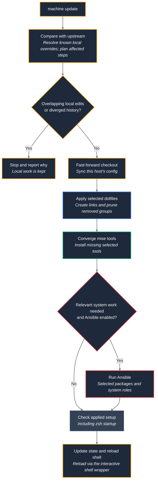

# Updates, status and attention

How `machine update` decides what to run, how it keeps local changes, how a failed apply is reverted, and what the prompt, `machine status` and `machine attention` show.

## Update

`machine apply --skip-ansible` syncs the applied host config but skips Ansible and bootstrap system provisioning for that invocation. `machine update --skip-ansible` still merges repository changes and applies dotfiles/user-space tools, but leaves system changes pending for a later `machine update --system` or `machine apply`. This is a one-run override; it does not write `ansible: false` to the host config. If both `--skip-ansible` and `--system` are passed to update, the explicit skip wins.

`machine update` only runs what changed upstream: the tool install (`mise install`, plus the Azure CLI via `uv tool`) for a changed `home/core/.config/mise/*`, the dotfile apply (`mise dot apply --prune`) for added/removed files under `home/` or a changed `mise.toml`, Ansible when `ansible/**` changed in a part that applies to this host (roles of features this host does not have, docs and inventory are ignored, and so is a feature-table change to `help` or `groups` only; a host never set up by Ansible or with `ansible: false` gets no system step), a host-config sync when `machine/hosts/**` changed. Local edits are kept: a trial merge (`git merge-tree`, nothing changes) decides whether an edited file that is also changed upstream merges cleanly; then the update keeps the edit and continues. Only a real conflict stops it. On a terminal it shows the diff (through delta) and the incoming commits, and offers *resolve manually* (default; prints the git commands, resolve outside `machine`) or *put the conflicting changes into the stash and update*; `--force` makes the second choice without asking. Stash entries made by `machine` are named `machine update <date>: <why>`; `machine status` counts them and `machine attention` shows each one and asks whether to restore, drop or keep it. When history diverged, a manual update rebases the local commits onto the upstream if a trial rebase (`git replay`) is clean, no local commit is on a remote branch, none is a merge commit, commit signing is off and no rebase/merge is in progress; otherwise it stops with `git pull --rebase` as the hint. If the only obstacle is an uncommitted change that conflicts with the incoming commits, it offers the same two choices as above (the stash choice stashes only the conflicting files, then rebases); without a terminal the reason names the files and says to commit, stash or discard them, then run `machine update`. `machine` puts `~/.local/bin` and the mise shims (`~/.local/share/mise/shims`) on `PATH` when they are missing, so over `ssh host '~/.local/bin/machine update'` (no login shell) it still finds `mise`, `bw` and Ansible. `machine update --check [--json]` shows the plan (including the files that merge cleanly and the conflicts) without changing anything. The background job (`machine update --auto`, every 6 hours via the user timer) applies home-only changes on its own and keeps local changes that merge cleanly; it stops on a conflict or a diverged history (it never stashes or rebases): it fast-forwards to just before the first commit that touches `ansible/**` or this host's config, runs the dotfile apply when needed, then runs the zsh health check; if zsh no longer starts it reverts to the previous revision, restores the local changes, does not retry that revision and shows needs-attention (the check output is kept for `machine attention`). A manual update runs the same zsh check; on a failure it shows the output, sets needs-attention and does not reload the shell. Everything from the first system commit on stays pending for a manual `machine update`. A manual update and `machine setup` run in the same order: env pull (`~/.env*` from Bitwarden, so its questions come before the long tool install), dotfile apply, tool install, then Ansible; setup says when the shell is ready in a new terminal while Ansible continues, and handles the SSH host key, the Tailscale login and the timers after Ansible. A failing step does not stop the steps that do not need it (the tool install and the zsh check need the dotfile apply); at the end both list every failed or skipped step and exit non-zero, and update sets needs-attention with the details for `machine attention`. Every `machine update` ends with a converge check (dotfile apply and tool install, also when nothing is incoming), and on a terminal the shell is reloaded afterwards by the `machine` shell function. A failed tool install reverts like a failed zsh check. When the incoming commits change `machine_cli/`, both the manual update and the background job run the steps after the checkout update with the new code: the running `machine` keeps the update lock, starts the checkout's `machine_cli/machine update` with internal `--resume-*` options and waits; in the background job it still does the revert itself, also when the new code crashes. It hands over only when the new checkout lists the running code's protocol version in `machine_cli/resume-protocol` (so a rollback to older code does not hand over). The update that brings this behaviour still runs the rest with the old code. `MACHINE_SKIP_TOOLS=1` skips the tool install in `machine setup` (tests). `machine setup` and `machine update` also enable systemd linger for the user (best effort, not in containers; on failure they print `sudo loginctl enable-linger <user>`), so the timer runs on headless hosts without a login. Managed blocks added to `~/.bashrc` by other tools are moved to `~/.bashrc-local` (sourced at the end of `.bashrc`).

## Prompt, status and attention

The background update check (`dotfiles-update-check-job`) and `machine update` write `~/.dotfiles-update-state` (`state`, `reason`, `revision`, `pending`, `failed_revision`, `ansible_applied_rev`, `stash`; the only state file). Interactive zsh and bash show it in the prompt (Starship `env_var` module; without Starship, at the right of the zsh prompt or as a `PS1` prefix in bash), re-read before every prompt without forking: `⬆ dotfiles update` (run `machine update`), `↻ reload shell` (an update was applied after this shell started; run `reload`), `⚠ dotfiles: check` (needs attention, e.g. diverged history; a line with the reason is also printed at shell start). A shell started after the update shows nothing. Next to it a red `⚠ disk /mnt/data 97%` segment names every filesystem low on space or inodes (read-write ext4, xfs, btrfs and vfat, found from the mounts; low below 5 % **and** below 20 GiB free, or below 5 % free inodes; per mount point `disk_space` in the host config, see [machine/hosts/README.md](../machine/hosts/README.md)). `machine` records it in `~/.local/share/machine/disk-state` at the end of every command and the user timer `machine-disk-check.timer` every 15 minutes (`machine disk` shows it, `--record` only writes the state); nothing is printed at shell start. `machine status` is a short overview (checkout path, branch and how far behind, the attention reason and what to run, incoming steps, local change counts, stash entries, low filesystems, host, features in columns, dotfile groups; colors only on a terminal); `machine status -v` adds the file lists, the applied host config and the dotfile groups file. `machine attention` (also plain `machine`, which prints the help when all is clean) lists open items (blocked or failed update, stash entries, pending system update, SSH key difference, local-override conflicts, Telegraf not installed / without output / not running on a host with `monitoring`, a filesystem low on space or inodes) and offers to resolve each on a terminal. The disk item names the mount point and its usage, shows the known space users on that filesystem (Docker data with `docker`, journal, apt cache, mise cache, `~/.cache`), cleans only what you pick and scans the biggest directories only on request. A blocked update comes first; while it is open the pending system step is part of it, so `machine apply` is not offered on the old checkout. When linking dotfiles, an existing regular file at a target is deleted if identical to the repository file, else moved to `<name>.pre-dotfiles`.

## Manual update flow

Preview with `machine update --check` (read-only), then run `machine update`. The diagram shows the normal local path; failure recovery and background updates are described above.

## Failed apply and restricted sudo

`machine apply` locally: if Ansible or the health check fails, the previously applied host config is restored. The health check fails when the zsh startup check fails or when the group configuration cannot be read (unprivileged checks only; telegraf is a warning). The output says which of the two failed; the hint about Ansible and sudo restrictions only appears for a failed Ansible run. When zsh only reports missing mise tools (`mise WARN missing: …`), `machine` runs `mise install` once and checks again before it restores anything. The same restore applies to the apply step of `machine update`. If the host config changed, Ansible runs again with the old state. Remote (`--limit`): no auto-revert — fix the host config in git and apply again.

The recovery Ansible run only happens when syncing the host config changed it;
an unchanged host config is restored without repeating the same failed command.
Package and system changes are not transactionally rolled back.

Local Ansible runs authenticate once: `machine` runs `sudo -v` in the terminal (fingerprint
or password, whatever PAM offers; skipped while the sudo ticket is valid) and then starts
`ansible-playbook` itself as root, so no task asks again. Tasks for the login user (the
Docker checks) switch to that user with `become_user`.
Without a terminal, or with `--no-become`, `machine` uses `sudo -n`: passwordless sudo or a
valid ticket works, anything else fails at once with a hint to run `machine` in a terminal.
When `machine` already runs as root (containers), Ansible runs without sudo. Remote runs
(`--limit`) still run Ansible as the user and ask for the remote become password.

A host whose sudo allows only selected commands must allow `ansible-playbook` (the path
`command -v ansible-playbook` prints) as root. `machine` checks this with `sudo -n -l`
before the run and stops with a message naming the command; a correct password does not
replace that permission, so ask the administrator for it. For a host where that is not
possible, set `ansible: false` in its host config: setup, apply and update then skip
Ansible, while dotfiles, tools and environment management stay active.
